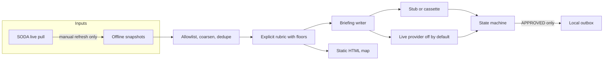

# Agentic events briefing lab

**Start here**

- Proves an explicit rubric ranks every life-safety incident above noise on a synthetic set, and a local outbox stays empty until an approval gate (simulated actor) is APPROVED.
- One command: `python3 -m events_briefing demo --offline`
- Docs: [docs/HOW_IT_WORKS.md](docs/HOW_IT_WORKS.md)

Recreated scenario with public data, not a client deliverable.

Architecture inspired by a team project; this is a personal recreation with public data, not a client deliverable.

`demo --offline` and `briefing` read snapshot files only. They do not call SODA or a model. `briefing --online` refreshes SODA for that run without rewriting the committed snapshots. The mode line is the refresh that happened: `online (SODA refresh then rank)` only when every pull succeeded. A partial snapshot fallback is labeled `mixed`, and a full fallback is labeled `snapshots`. `briefing --live` calls a model only when `LIVE_LLM=1`, `XAI_API_KEY`, `LLM_BASE_URL`, `LLM_MODEL`, both prices, and `MAX_LIVE_SPEND_USD` are set. If any of those are missing, the command exits 2, names each missing one, and does not call a model. The command `live` does not call a vendor.

`SOCRATA_RUN_BUDGET_S` (default 45 s) bounds only the SODA refresh. It does not bound the model, and it is not a cap on the whole `briefing --online --live` command. `MAX_LIVE_SPEND_USD` is the money cap for the model. `LLM_TIMEOUT_S` and `LLM_MAX_ATTEMPTS` bound model time. There is no single wall-clock cap for `--online --live`. The prompt includes borough counts the code already computed. The model copies them and does not count.

## Problem

A public incident feed mixes life-safety events with noise. A draft can also be mistaken for something that already left the building. This lab ranks a trimmed snapshot and refuses to publish unless the state machine is in `APPROVED`.

The fictional desk in the business notes is Editorial Muelle. It is not a client. The only measured rank result is the synthetic gate from 2026-10-17: 8 PASS, 0 FAIL, 0 INCOMPLETE, n=10, life-safety-above-noise rate 1.0. That is not a newsroom precision number and it is not nDCG. The time-saving arithmetic is **[EST]** and is not measured. Both are spelled out under Proof, Business value, and [docs/BUSINESS_CASE.md](docs/BUSINESS_CASE.md).

## Architecture



The default path is snapshot file, rubric, stub, approval gate (simulated actor), local outbox. The SODA node runs only for `refresh-snapshots --online` or `briefing --online`. The live node runs only for `briefing --live`. The approval gate checks an allowlist and an HMAC bound to the program id, the approved text, a one-time nonce, and the nonce-ledger head. Copying an APPROVED file onto another id is rejected. Deleting `nonce-ledger.json` and restoring an old APPROVED file is rejected. Restoring that ledger file together with the old APPROVED file still republishes, because the same key signs both. An authenticated channel is not built. See [docs/architecture.md](docs/architecture.md).

## Quickstart

Cost of the default path: **zero**. No API key. No network for tests, evals, or `demo --offline`.

```bash
python3 -m pip install -e ".[dev]"
python3 -m events_briefing demo --offline
```

That command reads `fixtures/snapshots/` only. It writes `out/map.html`, a briefing, a JSONL trace, and, after an approval gate (simulated actor) labeled **SIMULATED**, a local outbox file. It does not refresh SODA and it does not call a model.

`demo --offline`, `eval`, and `eval-regression` run from a clean clone. If `APPROVAL_STATE_KEY` is unset, those demo-mode commands use the public lab fixture `lab-simulated-not-a-secret`. Measured 2026-10-17 with the variable unset: `demo --offline` exit 0; `eval` exit 0; `eval-regression` exit 1. `briefing` is not demo mode. With the variable unset it exits 1 (`APPROVAL_STATE_KEY is empty`). With the public lab fixture it exits 1 and tells you to rotate the key. Rotate `APPROVAL_STATE_KEY` before any `briefing` run. The fixture is in the Makefile and `.env.example` on purpose, so anyone who can read the repo can forge a signature if a deployment still uses it.

```bash
python3 -m events_briefing briefing
python3 -m events_briefing briefing --online
python3 -m events_briefing briefing --live
```

`briefing` is the snapshot path and needs a rotated `APPROVAL_STATE_KEY`. `briefing --online` prints `requested=online` before the fetch, then `mode=` for the refresh that happened. It does not print `mode=online` when any pull fell back to a snapshot. `make` exports the public lab fixture. `make demo` and `make eval` may use it. `make briefing` refuses it.

| Make | Equivalent |
| --- | --- |
| `make setup` | `python3 -m pip install -e ".[dev]"` |
| `make lint` | `python3 -m ruff check src tests && python3 -m ruff format --check src tests` |
| `make typecheck` | `python3 -m mypy` |
| `make test` | `python3 -m pytest` |
| `make eval` | `python3 -m events_briefing eval` |
| `make eval-regression` | `python3 -m events_briefing eval-regression` (exits 1 when the gate catches the bug) |
| `make demo` | `python3 -m events_briefing demo --offline` |
| `make secretscan` | `python3 -m events_briefing secretscan` |

Copy `.env.example` only if you need local overrides. The app does not load `.env` by itself. Do not commit `.env`.

A fresh snapshot pull is manual and uses the network:

```bash
EVENTS_OFFLINE=0 python3 -m events_briefing refresh-snapshots --online
```

The committed snapshots were captured 2026-10-17. See [docs/DATA_SOURCES.md](docs/DATA_SOURCES.md).

## Use cases, governance and business strategy

### 1. Use cases

Client-style rows use fictional desks. They are patterns, not engagements.

| Use case | Status | Problem | Who approves | Gated effects | How this repo handles it |
| --- | --- | --- | --- | --- | --- |
| Editorial Muelle morning rundown | Implemented | Noise volume can bury a life-safety item | `simulated-editor` in the demo. A real approver is not built | Local outbox file only | Rubric floors, stub writer, state machine, trace |
| Shadow ranking beside a duty editor | Design only | The desk wants the rank next to today's routine before any send exists | Duty editor, named later | None during shadow | Documented in [docs/SCOPE.md](docs/SCOPE.md) phase 1. No scheduler is implemented |
| Field-crew dispatch from the briefing | Design only | Pressure to send it straight away | Not allowed in this lab | External dispatch | Not implemented. Publish from `DRAFT` raises. The eval asserts the outbox stays empty |

Walkthrough and other uses:

| Use case | Status | Problem | Who approves | Gated effects | How this repo handles it |
| --- | --- | --- | --- | --- | --- |
| Walkthrough for engineers and buyers | Implemented | Need a concrete system that shows the gate, not a chat transcript | The person running the demo | None leave the machine | `demo --offline` plus [docs/HOW_IT_WORKS.md](docs/HOW_IT_WORKS.md) |
| Personal civic scan of public feeds | Design only | One person still has to choose what matters | That person | A local note, if ever | Rubric and snapshots exist. No cron, no account |

### 2. Governance checklist

| Control | Where |
| --- | --- |
| Field allowlist and coarse location | `src/events_briefing/privacy.py`, `src/events_briefing/normalize.py` |
| Approval gate (simulated actor) before publish | `src/events_briefing/briefing/gate.py`, `config/approvers.json` |
| Traceability (inputs hash, rubric version, model leg, approval, publish) | `src/events_briefing/trace.py` |
| Risks | [docs/RISKS.md](docs/RISKS.md) |
| Costs | [docs/COST.md](docs/COST.md) |
| Incident and rollback | [docs/RUNBOOK.md](docs/RUNBOOK.md) |
| Spend cap and live switch default off | `src/events_briefing/providers/live.py`, `.env.example` |
| Secret scan | `src/events_briefing/secretscan.py`, CI job `secrets` |
| Invariant gate, including a forced red run | `src/events_briefing/evalkit/`, CI job `evals` |

Not covered yet:

- Authenticated approval. The lab gate is an approval gate (simulated actor): HMAC plus an allowlist. It is not an authenticated channel.
- Any external send (mail, chat, dispatch, broadcast).
- A reliable publish-claim control. The checker is a weak heuristic. Previous regex, 2026-10-17, n=20, small: paraphrase recall 0/20, negation false positives 3/20. External verification VERIFY_REPORT_9 the same day, n=20, small, not conclusive: post-change recall 7/20, false positives 3/20. This lab has not re-run that corpus (not measured yet).
- Live model quality, latency, or a paid invoice from this lab. An external check is cited in the results table. It is not a rate.
- A legal review for a real deployment.
- Multi-user auth, tenancy, or a streaming feed.

### 3. Business strategy

The business problem is attention: public incident volume hides the few items a desk would put first, and an unguarded draft can be treated as already sent. The ROI model is **[EST]** and lives in [docs/BUSINESS_CASE.md](docs/BUSINESS_CASE.md) and [docs/BUSINESS_VALUE.md](docs/BUSINESS_VALUE.md). Scope and phased rollout are in [docs/SCOPE.md](docs/SCOPE.md): this repo is phase 0 (offline lab); shadow is phase 1; a real gate on a channel the desk owns is phase 2 and is not built. Success metrics are in [docs/METRICS.md](docs/METRICS.md). Only the synthetic invariant rate, the zero default-path cost, and the test suite are measured.

For engineers and buyers, start with discovery, not a model demo. Ask who owns the rubric, who may approve, and what "publish" means in their tools. The rollout that matches this design is shadow, then gate. During shadow the ranking sits beside the current morning routine and a person records disagreements. A gate wraps one effect only after that, and only on a channel that desk owns. The editor owns approval. A data steward owns the field allowlist. A platform owner owns rollback and the spend cap. The model does not own the decision. This repo shows that split on a local outbox. It does not show their channel. Discovery questions are in [docs/DISCOVERY.md](docs/DISCOVERY.md). Handoff is in [docs/RUNBOOK.md](docs/RUNBOOK.md).

## Business value

Editorial Muelle is a fictional civic desk, not a buyer this repo has served. The value story is attention (life-safety above noise) and control (no local publish before approval). The only money arithmetic in the repo is **[EST]**: about 20 minutes at an illustrative 45 USD/hour is 15 USD per morning, and 15 USD times 20 mornings is 300 USD per month. This repo did not measure that saving, and it does not report an ROI percentage, because an adoption cost is not in the repo. The measured cost of the default path is 0 USD.

Full note: [docs/BUSINESS_VALUE.md](docs/BUSINESS_VALUE.md). The shorter case is [docs/BUSINESS_CASE.md](docs/BUSINESS_CASE.md). Prices and the external live rows are [docs/COST.md](docs/COST.md).

## Proof

**MEASURED 2026-10-22.** Package `events-briefing` 0.1.0. Python 3.12.3. pytest 9.1.1. pytest-cov 7.1.0. coverage 7.17.0. `APPROVAL_STATE_KEY` unset. Python sources at `a95e827` (this docs change does not change those sources). One run.

Command:

```bash
python3 -m pytest -o addopts= --cov=events_briefing --cov-report=term-missing --cov-fail-under=80
```

| Figure | Result |
| --- | --- |
| Tests | 56 passed |
| Line coverage | 91.83% of statements (2068/2252). `percent_statements_covered` was 91.82948490230906 |
| pytest-cov total | 88.51%. The footer printed `Total coverage: 88.51%`. `percent_covered` was 88.50889192886457 |

Branch coverage is on in `pyproject.toml` (`branch = true`), so the 88.51% total mixes statements and branches. The 80% floor applies to that total, not to the 91.83% statement figure. The term report's Cover column displays 89% because coverage.py rounds the total for that column. The 2026-10-17 note, on commit `61618ad9d63e78ab9fac014db52375fe4888b305`, recorded 55 passed and the same 88.51% total. It did not split out statement coverage. This run is 56 passed because this change adds one docs-contract test. That test sits outside `events_briefing`, so the statement counts above are the same as the 55-test run earlier the same day. The 2026-10-17 eval elapsed time (6.996 ms) was not remeasured on 2026-10-22.

## What this does NOT prove

- It does not prove a newsroom time saving, an editor-acceptance rate, or an ROI percentage. The 15 USD and 300 USD figures are **[EST]**.
- It does not prove nDCG or a precision number outside the synthetic set. The rate 1.0 is 3 of 3 life-safety incidents above every noise incident, n=10, on 2026-10-17.
- It does not prove live-provider quality, latency, or a paid invoice. External verification VERIFY_REPORT_11, 2026-10-17, model grok-4.20-0309-non-reasoning: 5 of 6 `briefing --live` runs accepted model text, and 0 of those runs were rejected for a borough count (n=6, small sample, not a rate). This lab did not re-run that (not measured yet).
- It does not prove the briefing text checker is a control. The text checker is not a reliable control. A category count scoped to a borough is only partially checked: false positives remain, and the form "Brooklyn saw 4…" is not covered. External verification VERIFY_REPORT_10, 2026-10-17, n=19 incorrect texts, small sample, not conclusive: 13/19 detected and 1/10 false positives. External verification VERIFY_REPORT_11, 2026-10-17, a different set (24 incorrect texts and 15 correct texts), small sample, not conclusive: 13/24 detected and 3/15 false positives. Those two sets are not comparable. This lab did not re-run either set (not measured yet). The checker also misses invented casualties and invented superlatives.
- It does not prove the publish-claim heuristic is a control. It is a weak heuristic. Previous regex: 0/20 paraphrase recall and 3/20 negation false positives (2026-10-17, n=20, small). External verification VERIFY_REPORT_9, same date, n=20, small, not conclusive: 7/20 recall and 3/20 false positives. This lab has not re-run that set.
- It does not prove an authenticated approver. The approval gate (simulated actor) checks an allowlist and an HMAC. Deleting the ledger and restoring an old APPROVED file is rejected. Restoring the ledger together with that file still republishes. An authenticated channel is still required outside this lab. The public lab key must be rotated outside demo mode; the code refuses that key on `briefing`.
- It does not prove a clean secret scan found every secret. Recall of the scanner is not measured.
- The 56 passed tests and the coverage figures prove this suite on this tree. They do not prove a deployment, an external send, or a legal review.

### What the lab also does not do

- It does not call a paid model in CI or in the default demo.
- It does not send email, chat, or dispatch.
- It does not put sensitive categories (sexual offenses, and the configurable domestic or child-related terms) on the public briefing or the map. Those rows are withheld without coordinates.
- It does not store exact addresses, names, phone numbers, or free-text descriptions.
- It does not treat FDNY borough centroids as source coordinates. The source has no point location; the centroid is a schematic marker labeled `borough_centroid`.

## Results

Eval, demo timing, and the secret scan below were measured 2026-10-17, package 0.1.0, Python 3.12.3. Eval and demo were run with `APPROVAL_STATE_KEY` unset. The unit-test row was printed again on 2026-10-22; see Proof. Commit for the 2026-10-17 note: `61618ad9d63e78ab9fac014db52375fe4888b305`.

| Check | Result | Command |
| --- | --- | --- |
| Invariant eval | 8 PASS, 0 FAIL, 0 INCOMPLETE; n=10; life-safety-above-noise rate 1.0; elapsed 6.996 ms (one run) | `python3 -m events_briefing eval` |
| Forced regression | exit 1; pass=1 fail=1 incomplete=0 | `python3 -m events_briefing eval-regression` |
| Unit tests | 56 passed MEASURED 2026-10-22 (55 on 2026-10-17; this change adds one docs-contract test). Statement coverage 91.83% (2068/2252). pytest-cov total 88.51% (floor 80%), same total as the 2026-10-17 note | `python3 -m pytest -o addopts= --cov=events_briefing --cov-report=term-missing --cov-fail-under=80` |
| Offline demo | exit 0; mode=snapshots; model_leg=stub; cost_usd=0.0; 67 public incidents; 1 sensitive row withheld; status PUBLISHED only after the simulated actor. Briefing markdown contained 2026-09-30 and did not contain 2026-10-01 | `python3 -m events_briefing demo --offline` |
| Demo timing | 5 runs, min 5.418 ms, median 5.789 ms, max 7.803 ms. p95 not measured | Python `time.perf_counter` around `run_offline_demo` |
| Secret scan | no findings | `python3 -m events_briefing secretscan` |
| Live provider quality | not measured in this lab. External verification VERIFY_REPORT_11, 2026-10-17, model grok-4.20-0309-non-reasoning: 5 of 6 `briefing --live` runs accepted model text, and 0 of those runs were rejected for a borough count (n=6, small sample, not a rate). This lab did not re-run that | `python3 -m events_briefing live` prints `expect_failures` and does not call a vendor |

Real-provider latency and quality are **not measured** in this lab. No "measured with real providers" claim is made.

### Design-only vs implemented

| Piece | State |
| --- | --- |
| SODA client with timeout, bounded retry, TTL cache | Implemented |
| Offline snapshots and `refresh-snapshots --online` | Implemented. Refresh is manual, not in CI |
| Normalize, dedupe, privacy allowlist, 2-decimal coordinates, geohash 6 | Implemented |
| Explicit rubric and deterministic rank | Implemented |
| Stub and cassette providers | Implemented |
| Live OpenAI-compatible provider behind env vars and a spend cap | Implemented and off. Quality not measured |
| Briefing JSON and Markdown | Implemented |
| State machine and local outbox | Implemented |
| Authenticated approval channel | Design only |
| Static offline HTML map with an OSM tile attribution control | Implemented. Tiles are not requested |
| Sensitive-category exclusion from the public briefing and map | Implemented. List in `config/sensitive_categories.json` |
| Invariant evals and forced regression | Implemented |
| JSONL trace and JSON logs | Implemented |
| External publish, streaming, multi-user auth | Design only / not covered |

## Decisions

- [ADR 0001](docs/adr/0001-offline-snapshots.md) offline snapshots are the default
- [ADR 0002](docs/adr/0002-coarse-location.md) coarse location and dropped free text
- [ADR 0003](docs/adr/0003-rank-floors.md) hard category floors
- [ADR 0004](docs/adr/0004-stub-provider.md) stub provider by default
- [ADR 0005](docs/adr/0005-local-outbox.md) local outbox and simulated approval
- [ADR 0006](docs/adr/0006-fail-closed.md) invalid model output fails closed
- [ADR 0007](docs/adr/0007-invariant-evals.md) invariant evals, not trajectories

## Security and known limits

Code in this repo is MIT. NYC Open Data snapshots are not relicensed; their terms stay the City's. See [NOTICE](NOTICE), [SECURITY.md](SECURITY.md), and [docs/DATA_SOURCES.md](docs/DATA_SOURCES.md).

## How to reproduce

Same commands as Quickstart. `make` may be absent; the `python3 -m` forms are enough. Forced regression must exit 1. CI fails that job if the exit code is 0.

## Next steps

- If a real desk adopts the pattern, run discovery in [docs/DISCOVERY.md](docs/DISCOVERY.md) and the shadow phase in [docs/SCOPE.md](docs/SCOPE.md) before any external effect.
- Do not treat the publish-claim heuristic as a control. External post-change recall was 7/20 with 3/20 false positives (VERIFY_REPORT_9, 2026-10-17, n=20, small, not conclusive). A re-run in this lab is not measured yet.
- Record a live provider run only with an explicit key, a spend cap, and a written date, model, and command. This lab's own live quality is not measured. An external check (VERIFY_REPORT_11) is cited above and is not a rate.

## Docs

| Doc | What it is for |
| --- | --- |
| [docs/HOW_IT_WORKS.md](docs/HOW_IT_WORKS.md) | Walkthrough for engineers and buyers |
| [docs/BUSINESS_VALUE.md](docs/BUSINESS_VALUE.md) | Buyer, levers, KPIs, [EST] ROI sketch, cost, measurement, risks |
| [docs/BUSINESS_CASE.md](docs/BUSINESS_CASE.md) | The 15 USD and 300 USD [EST] arithmetic |
| [docs/DISCOVERY.md](docs/DISCOVERY.md) | Ten questions and what the answer changes |
| [docs/SCOPE.md](docs/SCOPE.md) | Phases, out of scope, exit criteria |
| [docs/RISKS.md](docs/RISKS.md) | Probability, impact, mitigation, owner |
| [docs/METRICS.md](docs/METRICS.md) | What was measured, and what was not |
| [docs/COST.md](docs/COST.md) | Stub row at 0 USD, plus external live citations |
| [docs/RUNBOOK.md](docs/RUNBOOK.md) | Incident and rollback |
| [docs/architecture.md](docs/architecture.md) | Module map |
| [docs/ADAPT_TO_A_REAL_CLIENT.md](docs/ADAPT_TO_A_REAL_CLIENT.md) | What to throw away first |
| [docs/DATA_SOURCES.md](docs/DATA_SOURCES.md) | NYC Open Data terms and the committed capture |
| [docs/RUBRIC.md](docs/RUBRIC.md) | Floors and weights |
| [docs/PROVENANCE.md](docs/PROVENANCE.md) | What was not copied from a reference repo |
| [docs/adr/](docs/adr/) | Decisions |
| [NOTICE](NOTICE) | Snapshot terms sit outside the MIT grant |
| [SECURITY.md](SECURITY.md) | Reporting and known limits |
| [CHANGELOG.md](CHANGELOG.md) | What changed |

## Authorship and how this was built

This repository was built with AI-assisted development.

**What Diego Lescano set:**

- The problem and the scope: which failure to show, what is out of scope, and what the repo must not claim.
- The governance and business-strategy requirements: approval controls, traceability, risks and costs, an estimated ROI, rollout, and metrics.
- The engineering standards: Python, tests, CI, public snapshots plus a synthetic eval set, no client or employer data.
- Which measured limits are published as they are.

**What AI coding agents did:**

- Wrote most of the code, tests, and documentation from those briefs.

**What this repo does not claim:**

- It is not a production system. The incident snapshots are public NYC Open Data, trimmed. The eval set of n=10 is synthetic. Neither is a client dataset.
- The rate 1.0 is one synthetic gate. Live numbers cited from outside this lab are a small sample and were not re-run here.
