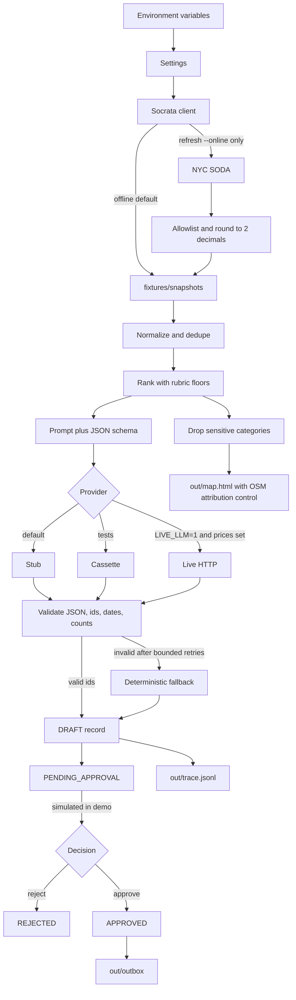

# Architecture

The model drafts a rundown. The system around it decides whether that draft can become a local file with status `PUBLISHED`.

## Modules

| Path | Role |
| --- | --- |
| `socrata.py` | Timeouts, per-fetch budget, SODA refresh budget (`SOCRATA_RUN_BUDGET_S` only; model money cap is `MAX_LIVE_SPEND_USD`), bounded backoff, TTL cache, snapshot fallback |
| `normalize.py` | Source allowlists to `Incident` |
| `ranking.py` | Deterministic score with group floors |
| `providers/` | Stub, cassette, optional live |
| `briefing/` | Prompt, text checks, approval gate (simulated actor), claim heuristic |
| `mapgen.py` | Self-contained HTML, no tile fetch, OSM attribution control |
| `evalkit/` | Invariants and the forced regression |
| `trace.py` | JSONL decisions |

## Trust boundaries

- Network is off unless `refresh-snapshots --online`, `briefing --online`, or `LIVE_LLM=1`.
- Snapshot files are the only incident input in CI.
- The outbox writer checks status `APPROVED` and a safe program id.
- Logs redact `SOCRATA_APP_TOKEN` and `XAI_API_KEY` when those values are non-empty.
